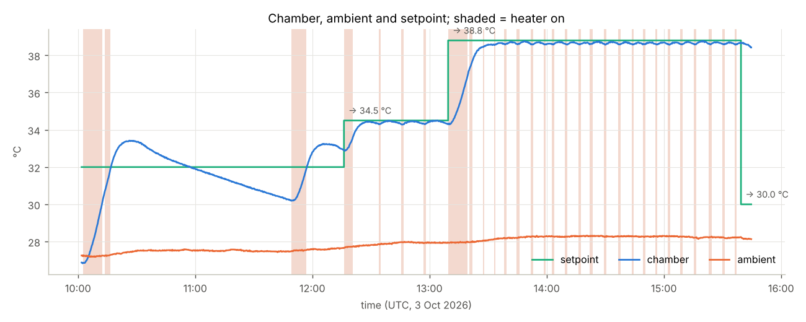
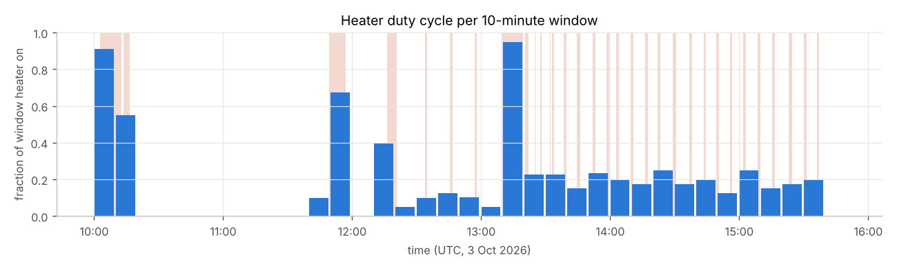
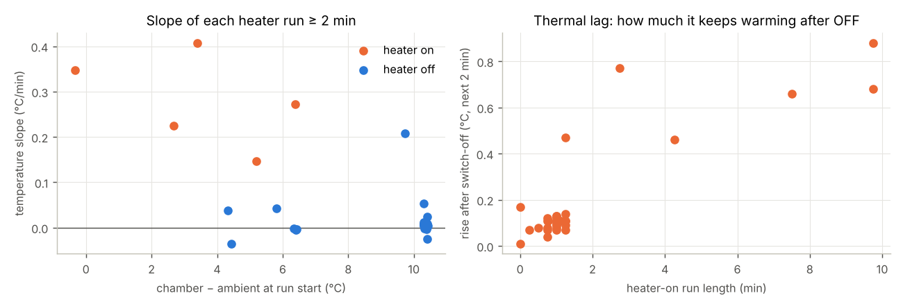
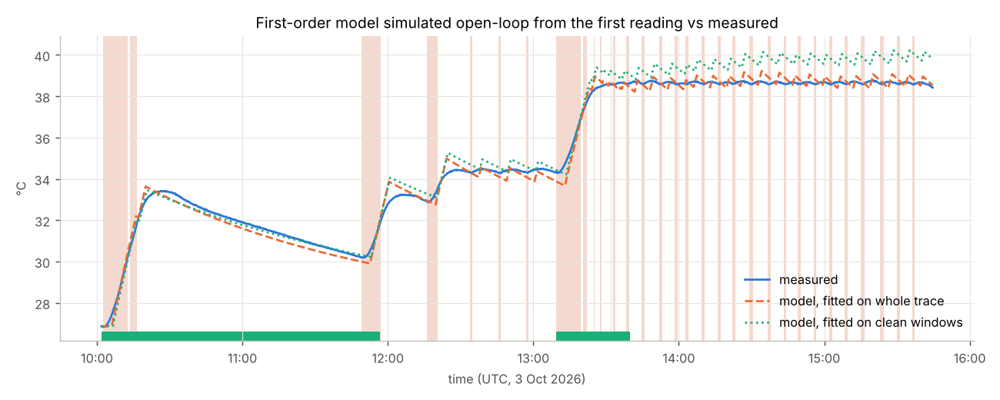
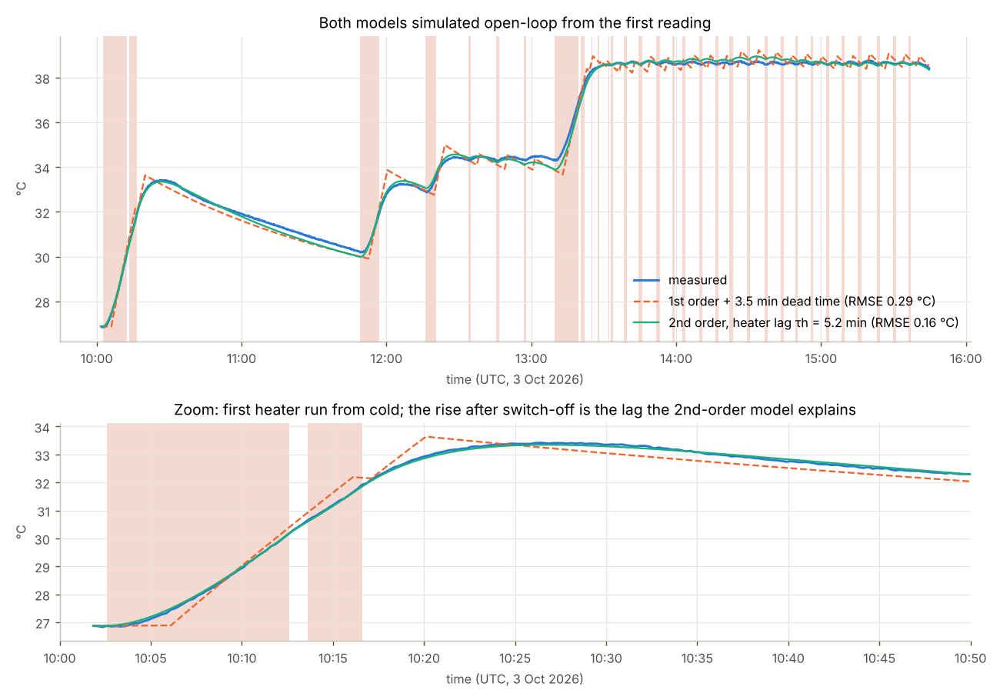
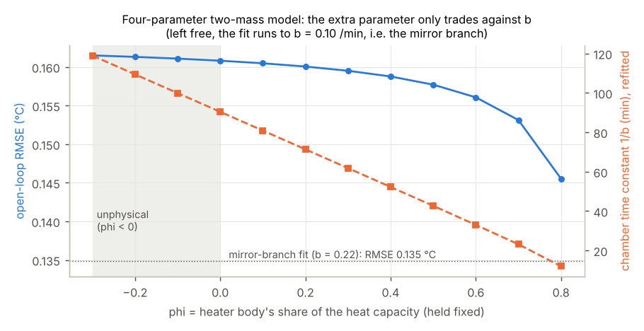
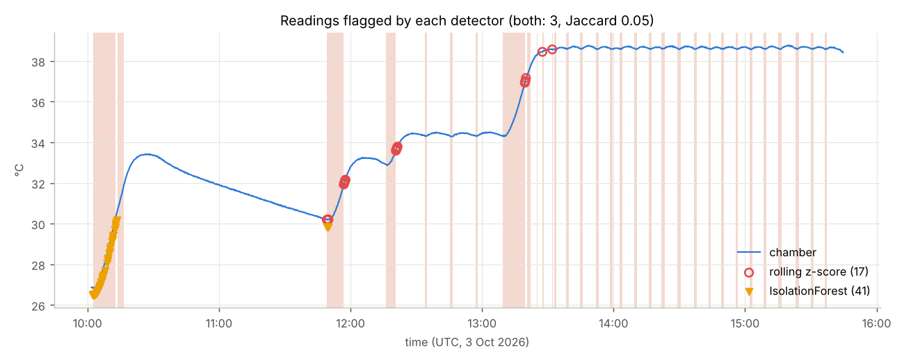
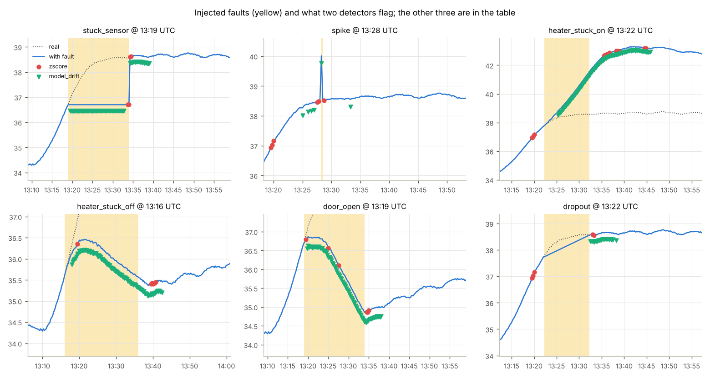
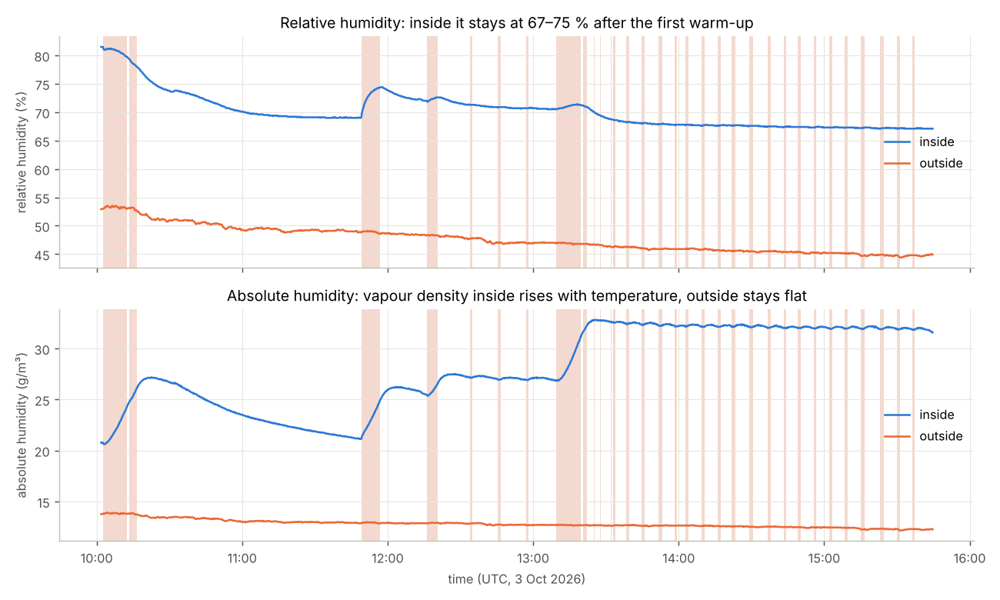
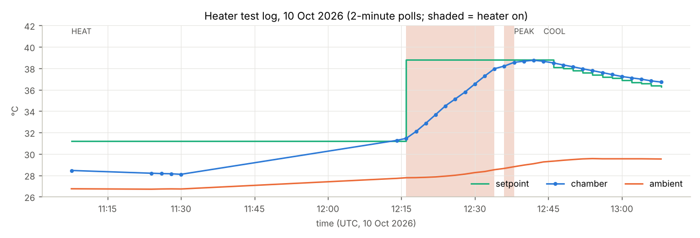

# incubator-telemetry-analysis

[](https://github.com/Mariam-zeqred/incubator-telemetry-analysis/actions/workflows/check.yml)

Analysis of real telemetry from one queen-bee incubator (the device whose firmware and apps
are in [queen-bee-incubator](https://github.com/Mariam-zeqred/queen-bee-incubator)). This
repo turns a day of 15-second readings into heater statistics, two fitted thermal models
whose parameters drive a control-simulation repo, and a scored comparison of four anomaly
detectors on injected faults. Every number below is produced by `scripts/make_figures.py`
and stored in `figures/results.json`; the model hand-over is `figures/model_params.json`.

```
data/*.json, *.csv ──► load.py ──► tidy UTC frame ──► features.py ──► segments, duty cycle, rates,
                                        │                               overshoot, absolute humidity
                                        ├──► thermal_fit.py ──► 1st-order (a, b, dead time)
                                        │                       2nd-order (a, τh, b)  ──► model_params.json
                                        │                       4-param two-mass: tried, not identifiable
                                        ├──► anomaly.py ──► z-score · IsolationForest · model drift · gaps
                                        └──► faults.py ──► inject 6 fault kinds, score the detectors
                                                        │
                       scripts/make_figures.py ◄────────┘ ──► figures/*.png + results.json
```

## Data

| File | What it is |
|---|---|
| `data/hive-1C5A00_history_2026-10-03.json` | 1 367 readings at 15 s, 3 Oct 2026 10:02–15:45 UTC: chamber and ambient temperature/humidity, setpoint, heater relay, door. Includes a hands-on session where the setpoint was stepped 32 → 34.5 → 38.8 → 30 °C. |
| `data/heater_stress_log_2026-10-10.csv` | A bench script's 2-minute polls during a heater test on 10 Oct 2026. **Only 33 rows (2 h) are in the repo**, not the full endurance run; it is used for one cross-check and the device-state columns (`runState`, `crashCount`, `reset`, `action`). |

## Run it

```bash
git clone https://github.com/Mariam-zeqred/incubator-telemetry-analysis && cd incubator-telemetry-analysis
python -m venv .venv && . .venv/bin/activate
pip install -r requirements.txt
make check          # ruff + pytest (35 tests) + regenerate figures/ and results.json (~90 s)
make notebooks      # rebuild the two exploration notebooks (outputs cleared)
```

## Results

### Timeline and duty cycle



The heater was on 19 % of the time overall. In the steady stretch at 38.8 °C (13:35–15:39 UTC)
it fired 19 short pulses (one per 6.5 min, duty 19 %) and held 38.65 °C mean, 38.57–38.77 °C
range, 10.4 °C above ambient.

### Heat-up, cool-down and thermal lag


| Quantity | Value (from the data) |
|---|---|
| Heat-up slope, heater runs ≥ 2 min (5 runs) | 0.15 – 0.41 °C/min; 0.35 °C/min from ambient |
| Heat-up slope in the 10 Oct test log (31.5 → 38.2 °C) | 0.35 °C/min, consistent with 3 Oct |
| Longest cool-down (92 min, heater off, ~4 °C above ambient) | −0.035 °C/min, 31.92 → 30.22 °C |
| Rise *after* switch-off following the three long runs (7.5–10 min) | +1.4, +1.9, +3.4 °C, peaking 9–16 min after OFF |
| Time to target / overshoot: 32 °C (from cold) | 14.8 min / **+1.42 °C** |
| Time to target / overshoot: 34.5 °C | 9.0 min / 0.00 °C |
| Time to target / overshoot: 38.8 °C | 24.8 min / −0.03 °C |

The lag is the main story: after several minutes of heating the chamber keeps warming for a
quarter of an hour. The long first run from cold produced the 1.4 °C overshoot; the later
steps, driven by short pulses, did not.

### Thermal models: first order with a dead time, then a heater-lag model



Both are fitted by simulating the model and minimising the temperature error (not by
regressing on noisy 15-second differences). First order: `dT/dt = a·u(t − d) − b·(T − T_out)`.
Second order: the heat reaching the chamber, `E`, lags the relay: `dE/dt = (a·u − E)/τh`,
`dT/dt = E − b·(T − T_out)`.

| Fit (whole trace, 1 367 readings) | a (°C/min) | b (1/min) | τ = 1/b (min) | lag | RMSE open-loop |
|---|---|---|---|---|---|
| First order + dead time | 0.554 ± 0.002 | 0.0101 ± 0.0001 | 99 ± 1 | 3.5 min dead time | 0.29 °C |
| Second order (heater lag) | 0.591 ± 0.002 | 0.0111 (SE < 0.0001) | 90 ± 0.3 | τh = 4.9 ± 0.1 min | **0.16 °C** |

The lag model needs no dead time (a grid over 0–1 min of dead time picks 0), halves the error
and reproduces the rise after switch-off: measured +3.37 / +1.43 / +1.85 °C after the three
long runs, lag model +3.32 / +1.51 / +2.18 °C, with the peak 14 / 10 / 16.5 min after OFF
versus 14 / 9 / 16 min measured. The first-order model gets the first peak right only
because its dead time was tuned on it, and overshoots the other two by 0.4 °C.

Two caveats, both in `thermal_fit.py`'s docstring. (1) The ± values are least-squares
standard errors with autocorrelated residuals, so they are optimistic. (2) The lag model has a
mirror solution (slow heater, fast chamber: τh = 100 min, 1/b = 4.5 min) that fits this
day *slightly better* (RMSE 0.135 °C) because the outside sensor rose by 1 °C together with
the chamber (correlation 0.96). It is rejected on direct evidence: during the 92-minute
heater-off stretch the chamber lost 0.035 °C/min at ~4 °C above ambient, i.e. b ≈ 0.01, not
0.2. Only `a`, `τh` and `b` are identifiable from temperatures; `R`, `C` and `P` separately
need the heater's electrical power (`FirstOrderFit.physical(heater_power_w)` does that).



**Why not a fourth parameter?** The general two-mass model (`fit_two_mass`) adds φ, the
heater body's share of the heat capacity; φ = 0 is the lag model. On this day φ is not
identifiable: holding it anywhere from −0.2 to 0.4 and refitting the rest changes the RMSE by
1.6 % while τ = 1/b slides from 109 to 52 min to compensate; left free, the fit runs to the b
bound, i.e. into the mirror solution (φ = 0.82, RMSE 0.143 °C); with b pinned to the
model-free cool-down value (0.0093 /min) φ lands at −0.18, outside its physical range. Three
parameters are kept because the fourth cannot be determined from one sensor and 1 °C of
ambient variation, not because it was measured to be zero.

### Anomaly detectors on the real day


There is no labelled fault in this day. The rolling z-score of the temperature slope (per heater
state, window 40, |z| > 3) flags 17 readings in 6 short episodes, all at heater switches during the
big setpoint steps. The IsolationForest (3 % contamination) flags 41 readings, 38 of them the
initial warm-up from cold. The *drift* of the measured temperature from what the lag model predicts
over the last 5 min (threshold 0.22 °C = this day's 99.7th percentile) flags 5. The
sampling-interval watchdog (gap > 60 s) flags one: a real 74 s gap at 12:15 UTC.

### Scored on injected faults


To get numbers, `faults.py` injects six fault kinds at 20 random positions each into the real trace
and scores every detector. Sensor faults (stuck 15 min, a +1.5 °C spike, a 10-min dropout) edit the
readings; physical faults (relay stuck on 10 min, stuck off 20 min, door open 15 min = loss ×4) are
**synthesised with the fitted lag model** and added to the measured temperature, the honest limit
of what one real day allows. "Detected" means any flag inside the fault window plus a 5-min settle
margin; *null* is how often the same detector "detected" that window on the clean day, i.e. the
chance floor. Precision/recall are per reading, pooled over trials; false alarms are episodes per
trial outside the fault. Omitted from the table (full table in `results.json`): the two
IsolationForest variants (refitted per trace, and fitted on the clean day), which sit at or within
a few trials of their chance floor on every fault (best case 30 % detected against a 15 % floor,
stuck sensor), and the interval watchdog, which by construction detects 100 % of dropouts at a 0 %
floor and nothing else (its precision of 0.5 is the clean day's own 74 s gap counted against it).

| Fault | z-score: detected / null · prec · rec · false alarms | Model drift: detected / null · prec · rec · false alarms |
|---|---|---|
| Sensor stuck 15 min | 100 % / 40 % · 0.14 · 0.04 · 5.3 | 60 % / 20 % · 0.78 · 0.27 · 1.0 |
| Spike +1.5 °C | 100 % / 10 % · 0.00 · 0.00 · 5.6 | 100 % / 5 % · 0.16 · 1.00 · 1.3 |
| Relay stuck ON 10 min | 80 % / 25 % · 0.21 · 0.11 · 6.2 | 100 % / 5 % · 0.47 · 0.78 · 1.8 |
| Relay stuck OFF 20 min | 65 % / 40 % · 0.06 · 0.01 · 5.8 | 85 % / 25 % · 0.78 · 0.53 · 1.4 |
| Door open 15 min | 95 % / 40 % · 0.25 · 0.09 · 5.5 | 100 % / 20 % · 0.93 · 0.92 · 1.0 |
| Dropout 10 min | 25 % / 10 % · 0.00 · 0.05 · 5.5 | 85 % / 0 % · 0.04 · 0.80 · 1.7 |

What this says: the z-score "detects" almost everything because it fires 5–6 false episodes
per day anyway (its null rate for a 15-min window is 40 %); its reading-level precision is
below 0.25 everywhere. The model-drift detector is the only one that separates the physical
faults from normal operation (door open: precision 0.93, recall 0.92; relay stuck on: 100 %
detected against a 5 % floor) with one to two false episodes per day. It is weak on a stuck
sensor during steady state, where the model also predicts "no change", and it catches a
dropout only because its one-step prediction across a 10-minute hole is poor, which is a
side effect; the interval watchdog is the right tool for that. The IsolationForests spend
their 3 % budget on the cold start, the most unusual *normal* state.

### Humidity


Relative humidity inside stayed at 67–75 % after the first warm-up while the chamber went
from 30 to 38.8 °C; outside it was 44–54 %. As absolute humidity (Magnus formula,
`features.absolute_humidity`) the vapour density inside rose from 21.8 g/m³ in the first
10 min to 31.9 g/m³ in the last 10 min (correlation with chamber temperature 0.98), outside
it stayed at 12.8 ± 0.4 g/m³. So the chamber is not drying out as it warms: something inside
releases water vapour fast enough to hold RH nearly constant. This data cannot say what (a
water reservoir, wax, wood); that is a question for the hardware.

### Heater test log (10 Oct)


The device was `PAUSED` on firmware 1.1.5 when the script started, was auto-resumed, then ran one
heat-up to 38.75 °C and a scripted cool-down (setpoint lowered 0.1–0.2 °C every 2 min).
`crashCount` went 6 → 7 with reset reason "other watchdog" and alarm `W01` raised throughout. Too
short for any endurance claim.

## Findings the data supports
- Full-power heating from ambient is about 0.35 °C/min on both days; the fitted full-power
  rate once the heater is warmed through is 0.59 °C/min, reached with a 5-minute lag.
- Cooling near 4 °C above ambient is about 0.035 °C/min; the chamber time constant is 1.5 h.
- The dominant control problem is lag: up to 3.4 °C of post-switch rise after a long heater
  run, which produced a 1.4 °C overshoot on the first approach. A heater-lag model explains
  it with no dead time; a first-order model needs a 3.5-min dead time and still misses. The
  heater body's share of the heat capacity is not identifiable from this day (figure 10).
- Once near the setpoint the firmware's short pulses held a 0.2 °C band, slightly below target.
- A detector that knows the thermal model finds relay and door faults with precision above
  0.47 and one to two false alarms per day; slope statistics and IsolationForest do not.
- Vapour density inside rises with temperature; the chamber does not dry out as it warms.

## Limitations
One device, one day of history plus two hours of test log; one ambient (27–28 °C); the door
shut throughout; no *real* faults, so the detector scores rest on injected ones whose physical
kinds are model-synthesised. The models are lumped and linear; the humidity reading is one
sensor with no calibration check.

## Relation to the published work
The incubator and its control approach are described in "Design and Development of a Smart
Incubator for Bee Queens Based on IoT Technology", *Journal of Computer Science and
Engineering Research* 3(1), June 2026, DOI
[10.64820/AEPJCSER.31.13.22.62026](https://doi.org/10.64820/AEPJCSER.31.13.22.62026). This
repo adds the quantitative look at the device's heating behaviour that the paper did not
include; `figures/model_params.json` feeds the companion control-simulation repo.

## Next steps
See `TODO.md`: more days of data and the real heater power to turn `a` and `b` into R, C
and P. The file map is in `WALKTHROUGH.md`.
